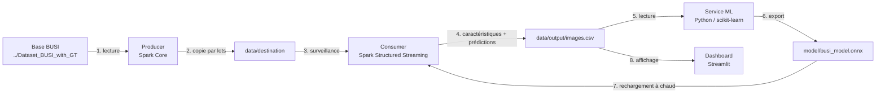

# BUSI – Spark Streaming

Classification en temps réel d'échographies mammaires (base **BUSI** : *Breast Ultrasound Images*)
en trois classes : **benign**, **malignant** et **normal**.

Les images arrivent au fil de l'eau ; Spark Structured Streaming en extrait des caractéristiques,
un service Python entraîne un modèle et l'exporte en ONNX, et le consumer Spark l'utilise
pour prédire chaque nouvelle image. Un dashboard Streamlit affiche le tout en direct.

📄 **Explication détaillée et simple de tout le projet : [BUSI_SparkStream.pdf](BUSI_SparkStream.pdf)**

## Architecture



| Composant | Fichier | Rôle |
|---|---|---|
| Producer | [`src/main/scala/Producer/FileProducer.scala`](src/main/scala/Producer/FileProducer.scala) | Copie les images de la base dans `data/destination`, par lots, pour simuler un flux. Ignore les masques (`*_mask.png`). |
| Consumer | [`src/main/scala/Consumer/ImageConsumer.scala`](src/main/scala/Consumer/ImageConsumer.scala) | Détecte chaque nouvelle image, calcule ses caractéristiques (intensité, contraste, texture…), la prédit avec le modèle ONNX et écrit les résultats dans `data/output/`. |
| Modèle ONNX | [`src/main/scala/Consumer/OnnxModel.scala`](src/main/scala/Consumer/OnnxModel.scala) | Charge `model/busi_model.onnx` et le recharge dès que le service ML en exporte un nouveau. |
| Service ML | [`ml_service/train_model.py`](ml_service/train_model.py) | Lit `images.csv`, entraîne une forêt aléatoire, l'évalue (validation croisée) et l'exporte en ONNX. Ré-entraîne au fur et à mesure que des images arrivent. |
| Dashboard | [`dashboard/app.py`](dashboard/app.py) | Affiche les images reçues, la précision, la matrice de confusion, et permet d'envoyer ses propres images. |

Tous les paramètres (dossiers, taille des lots, fréquence des micro-batchs…) sont dans
[`src/main/resources/application.conf`](src/main/resources/application.conf).

## Prérequis

- **Java 17**
- **sbt** (le projet utilise sbt 2.0.8, téléchargé automatiquement)
- **Python 3.11** et les dépendances : `pip install -r requirements.txt`
- **Windows uniquement** : `winutils.exe` et `hadoop.dll` (Hadoop 3.3) dans un dossier `...\hadoop\bin`,
  et la variable d'environnement `HADOOP_HOME` qui pointe vers `...\hadoop`.

## Données

La base complète n'est pas dans le dépôt (trop volumineuse). Téléchargez
[*Breast Ultrasound Images Dataset*](https://www.kaggle.com/datasets/aryashah2k/breast-ultrasound-images-dataset)
(780 images + masques de segmentation) et placez le dossier `Dataset_BUSI_with_GT` **à côté** du projet :

```
Bureau/
├── Dataset_BUSI_with_GT/
│   ├── benign/      (437 images)
│   ├── malignant/   (210 images)
│   └── normal/      (133 images)
└── BUSI_Spark_Streaming/   (ce dépôt)
```

Pour un essai rapide sans télécharger la base, `data/Source/` contient 27 images d'exemple :
mettez `source-dir = "data/Source"` dans `application.conf`.

## Lancement

Depuis la racine du projet, dans **quatre terminaux**, dans cet ordre :

```bash
# 1. consumer : attend les images dans data/destination
sbt "runMain Consumer.ImageConsumer"

# 2. service ML : entraîne le modèle dès qu'il y a assez d'images
python ml_service/train_model.py --retrain-every 50

# 3. dashboard : http://localhost:8501
streamlit run dashboard/app.py

# 4. producer : envoie les images de la base
sbt "runMain Producer.FileProducer"
```

> Deux sbt ne peuvent pas toujours tourner en même temps sur le même projet. Si le producer
> refuse de démarrer, lancez-le d'abord seul, puis le consumer : celui-ci traitera toutes les
> images déjà déposées.

### Options du service ML

| Option | Défaut | Rôle |
|---|---|---|
| `--once` | – | Un seul entraînement puis arrêt |
| `--interval` | 10 | Secondes entre deux lectures de `images.csv` |
| `--retrain-every` | 6 | Nombre de nouvelles images avant un ré-entraînement |
| `--min-per-class` | 2 | Images minimum par classe pour entraîner |
| `--balance` | – | Même nombre d'images par classe (celui de la plus petite) |
| `--idle-timeout` | 600 | Arrêt après ce nombre de secondes sans nouvelle image |

### Repartir de zéro

Videz `data/destination`, `data/checkpoint`, `data/output` et `data/staging`, et supprimez
`model/busi_model.onnx`. Sans ça, Spark se souvient (checkpoint) des images déjà traitées
et ne les retraite pas.

## Caractéristiques extraites

Le modèle ne voit pas l'image : il reçoit 37 nombres calculés par le consumer sur l'image en niveaux de gris.

| Groupe | Colonnes | Ce que ça mesure |
|---|---|---|
| Intensité | `meanIntensity`, `stdIntensity`, `entropy`, `gradient` | Luminosité, contraste, variété des niveaux de gris, quantité de contours |
| Histogramme | `h00` … `h15` | Répartition des niveaux de gris en 16 classes |
| Texture GLCM | `glcmContrast`, `glcmHomogeneity`, `glcmEnergy`, `glcmCorrelation` | Ressemblance entre pixels voisins (zones lisses ou granuleuses) |
| Texture LBP | `lbp0` … `lbp9` | Motifs locaux : bords, coins, zones plates, motifs irréguliers |
| Zone centrale | `centerMean`, `centerStd`, `centerRatio` | Luminosité et contraste du centre, où se trouve souvent la lésion |

`width` et `height` sont calculées (et affichées) mais **pas utilisées** par le modèle : dans la base BUSI,
la taille des images varie selon la classe, et le modèle apprendrait ce biais plutôt que l'aspect de l'échographie.

## Résultats

Forêt aléatoire de 200 arbres, validation croisée à 5 groupes sur les 780 images :

| Version | Précision | Rappel benign | Rappel malignant | Rappel normal |
|---|---|---|---|---|
| Intensité + histogramme + taille, `max_depth=6` | 61,3 % | 62 % | 59 % | 62 % |
| **+ GLCM + LBP + zone centrale, sans taille, arbres complets** | **74,5 %** | **81 %** | **68 %** | **62 %** |

Le *rappel malignant* est la part des cancers correctement détectés : c'est le chiffre le plus important
dans un contexte médical.

Les métriques du dernier modèle sont dans `data/output/model_metrics.json`
(précision en validation croisée, matrice de confusion, importance des caractéristiques)
et l'historique des entraînements dans `data/output/model_history.csv`.
